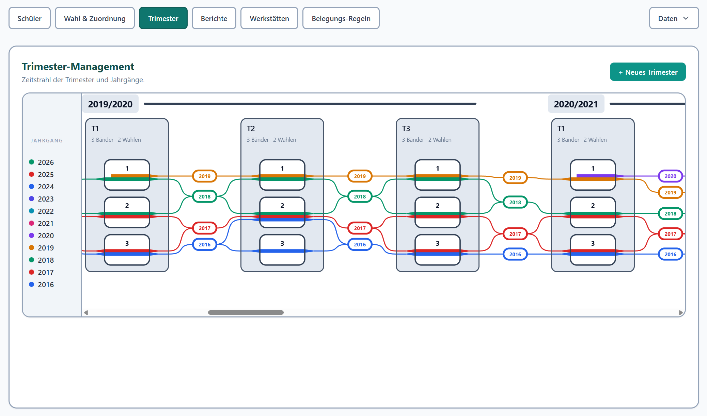
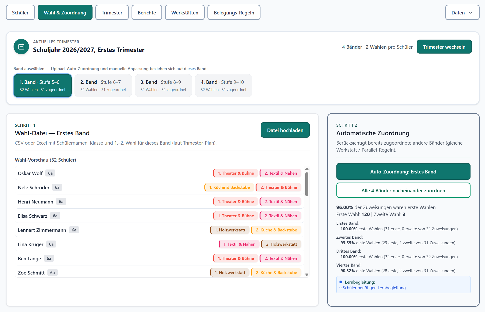
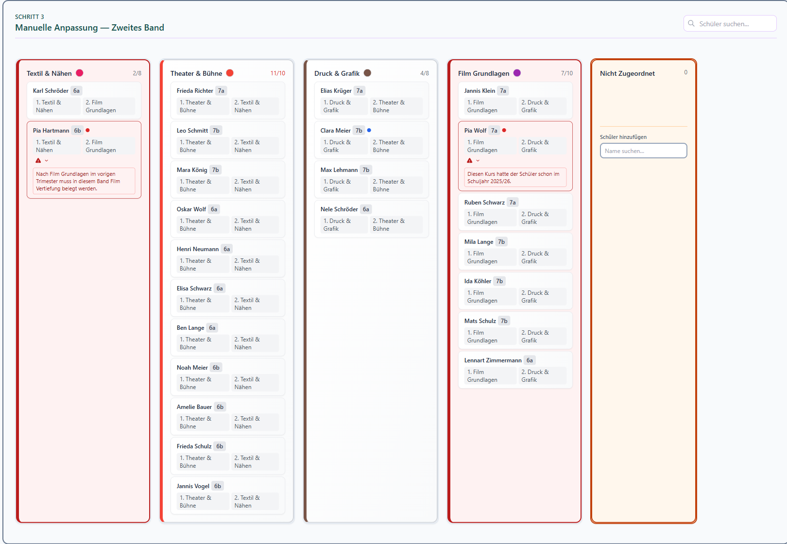
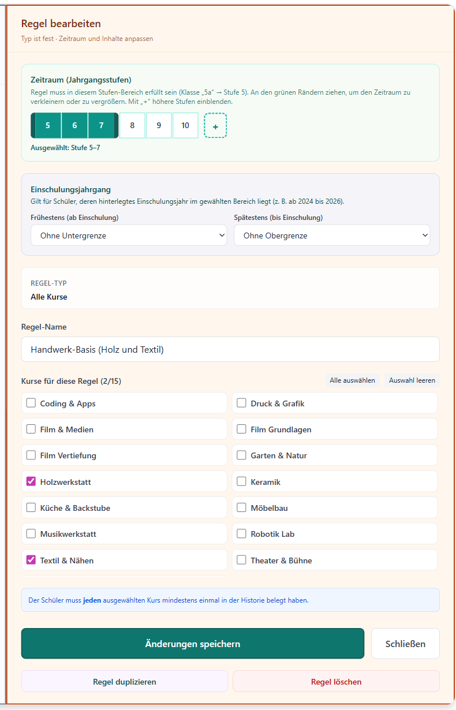

# Werkstatt-Verwaltung

Kurse planen, Wahlen zuordnen und über mehrere Schuljahre im Blick behalten. Ein Schuljahr hat drei Trimester. Jeder Jahrgang läuft als farbige Linie durch die Bänder.

Die Seite liegt unter [jasperwi.github.io/Werkstaette](https://jasperwi.github.io/Werkstaette/).

## Trimester

Der Zeitstrahl zeigt, welches Trimester schon belegt ist und welches nur geplant. Gestrichelte Kästen sind noch offen. Die Linien gehören zu den Einschulungsjahrgängen und laufen nur durch die Bänder, in denen dieser Jahrgang wählt.



Steht zwischen den Kursen **und**, müssen beide belegt werden. Das ist die Regel „Alle Kurse“. Eine Regel heißt nicht plötzlich „oder“, nur weil das Wort im Namen vorkommt. „Oder“ und „n von diesen“ kommen von der Regel **Mindestanzahl**.

## Wahl und Zuordnung

Pro Band eine Wahl-Datei hochladen, dann automatisch zuordnen oder die Karten von Hand ziehen. Ein Hinweis bleibt auf der Schülerkarte, solange die Bedingung gilt, und lässt sich auf das Warndreieck einklappen. Eine volle Werkstatt erkennt man an der roten Zahl in der Spalte, nicht an einem Hinweis auf jeder Karte.



Im offenen Trimester der Zehn-Jahres-Demo liegt nach der automatischen Zuordnung fast jede Karte auf einer abgegebenen Wahl. Im zweiten Band bleiben zwei Hinweise stehen, und Theater & Bühne ist um einen Platz über der Kapazität.



## Belegungs-Regeln

Vier Arten:

- **Alle Kurse** — jeder ausgewählte Kurs mindestens einmal, zum Beispiel Holzwerkstatt und Textil.
- **Mindestanzahl** — nur so viele Kurse aus einer Liste, zum Beispiel einer von zweien oder zwei von vier.
- **Folgekurs** — nach einem Kurs im nächsten Trimester ein bestimmter Kurs, auf Wunsch im selben Band.
- **Freitext** — eine Erinnerung zum Abhaken, ohne Kursliste.

Der Zeitraum ist eine Spanne von Klassenstufen. Zusätzlich kann die Regel auf einen Einschulungsjahrgang begrenzt werden. Im Editor bleibt der Typ einer bestehenden Regel fest; Zeitraum, Name und Kurse lassen sich anpassen.



## Werkstätten

Jede Werkstatt hat Farbe, Kapazität, Lehrkraft und Raum. Läuft sie in mehreren Bändern mit anderem Raum oder anderer Lehrkraft, bekommt das Band eine eigene Variante. Kurse, die nicht mehr laufen, lassen sich archivieren.

## Daten

Oben rechts liegt der Export und der Import als ZIP. Ein Wahl-Upload ändert einen gesetzten Jahrgang nicht. Ersetzt ein ZIP auf diesem Weg alle Daten, werden fehlende Einschulungsjahre aus dem letzten Trimester mit Klasse ergänzt.

Zum Ausprobieren liegen zwei Beispieldateien unter `scripts/output/`: die kleinere `werkstatt-demo.zip` und `werkstatt-demo-10-jahre.zip` über zehn Schuljahre.

## Starten

```bash
npm install
npm start
```

Die App öffnet sich unter [http://localhost:3000](http://localhost:3000).
